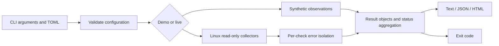

# Architecture

`cli.py` owns arguments, config validation, mode selection, output, and exit codes. `collectors.py` reads Linux interfaces and calls the single permitted external program, systemctl, using an argument list and timeout. `core.py` owns portable results, thresholds, aggregation, and report serialization.

Checks run sequentially so evidence ordering remains predictable and collection puts little pressure on a server. Each job isolates expected operating-system, parsing, and timeout failures. Unexpected programming errors are not silently converted into healthy results.

The CLI is deliberately local and stateless. There is no server, database, browser dependency, or agent installation. TOML and standard-library testing avoid runtime dependency management on locked-down hosts. The packaging backend is a build-time dependency only.

Trust boundaries: configuration is user input; procfs/sysfs and command output are evidence, not commands. Unit validation and `shell=False` behavior prevent shell interpretation. Renderers escape HTML. Unknown evidence remains distinct from an operational failure. Reports include only deliberately selected evidence, but are not a general-purpose anonymization system.

Extension rule: future collectors must return the existing Result contract, distinguish unsupported from failed, provide fixtures and negative tests, and declare any required permissions. Hardware plugins and remote transports require separate design review rather than being placed inside core evaluation code.

Key tradeoffs: simple snapshot collection over continuous monitoring; explicit targets over noisy autodiscovery; no automatic repair; no cgroup interpretation yet; no hard timeout on local filesystem operations. These limits are documented in the README and runbook.
